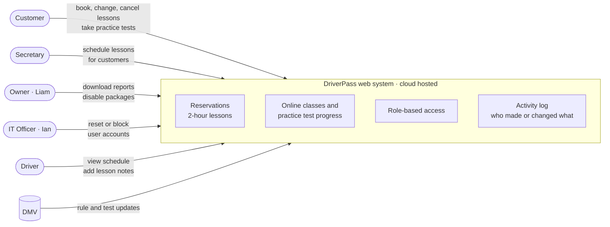

# DriverPass: System Analysis and Design (CS 255)

Requirements analysis and UML system design for **DriverPass**, a startup that helps students pass their DMV driving tests with online classes, practice tests, and scheduled on-the-road lessons.

Built for **CS 255: System Analysis and Design** at Southern New Hampshire University.

---

## System Overview

## Deliverables

| Document | Contents |
|---|---|
| [Business Requirements Document](Business-Requirements-Document.docx) | Purpose, background, objectives, functional and nonfunctional requirements, assumptions, limitations, and a Gantt chart timeline |
| [System Design Document](System-Design-Document.docx) | UML use case, activity, sequence, and class diagrams, plus technical requirements |

## Key Requirements Captured

- Schedule, change, and cancel **two-hour driving lessons**, each matched with a driver and a car
- Track **online test progress** for each customer
- **Log who made or changed every reservation**
- Run on the **web in the cloud**, on both computers and phones
- Give **different access levels** to customers, staff, and administrators
- Stay up to date with **DMV rule changes**

## Skills Demonstrated

Requirements gathering from client interviews · functional vs. nonfunctional requirements · UML modeling (use case, activity, sequence, class) · Lucidchart · project scheduling

---

## Reflection

**Briefly summarize the DriverPass project. Who was the client? What type of system did they want you to design?**

The client was DriverPass, a new company Liam started after noticing that many people failed their driving tests at the DMV. He wanted a system that would help customers prepare by offering online classes, practice tests, and on-the-road driving lessons. The system needed to let customers and the secretary schedule, change, and cancel two-hour lessons; match each lesson with a driver and car; track online test progress; and log who made or changed each reservation. It also had to run on the web in the cloud, work on computers and phones, give different access to different users, and stay up to date with DMV rules.

**What did you do particularly well?**

I think I did well at turning the interview into clear requirements and then keeping my diagrams consistent with them. I can trace every use case, activity, and class in my design back to something Liam or Ian asked for, like the activity log, disabling a package, and the DMV updates. I also learned a lot about using Lucidchart. I built the diagrams by hand at first, then learned to use tools like UML markup to work faster, while still checking every detail myself.

**If you could choose one part of your work on these documents to revise, what would you pick? How would you improve it?**

I would revise my sequence diagram. To keep it clear, I only showed the main successful path for scheduling a lesson. If I revised it, I would add an "alt" frame to show what happens when login fails or when the driver and car are no longer available, so developers can see how the system should handle those cases.

**How did you interpret the user's needs and implement them into your system design? Why is it so important to consider the user's needs when designing?**

I read through the interview and wrote down everything each user needed to do: customers, the secretary, drivers, Liam, and Ian. Then I turned those needs into functional and nonfunctional requirements and built the diagrams around them. For example, Liam wanted to know who made, changed, or canceled a reservation, so I added an ActivityLog class and a "log who made it" step to the scheduling flow. Considering user needs matters because a system can work perfectly on the technical side and still fail if it doesn't solve the client's real problems. It's also much cheaper to get the requirements right at the start than to fix them after the system is built.

**How do you approach designing software? What techniques or strategies would you use in the future to analyze and design a system?**

I start by understanding the problem and the users before thinking about technology. I collect the requirements, organize them into functional and nonfunctional, and then use UML diagrams to model the system from different views: use case diagrams for who does what, activity diagrams for the steps, sequence diagrams for how the parts talk to each other, and class diagrams for the data. In the future, I would keep using these techniques, check in with the client often to confirm I understood them correctly, and build simple prototypes or mockups early so the client can give feedback before development starts. I would also keep my documents updated whenever the design changes, since developers depend on them to build the system correctly.
